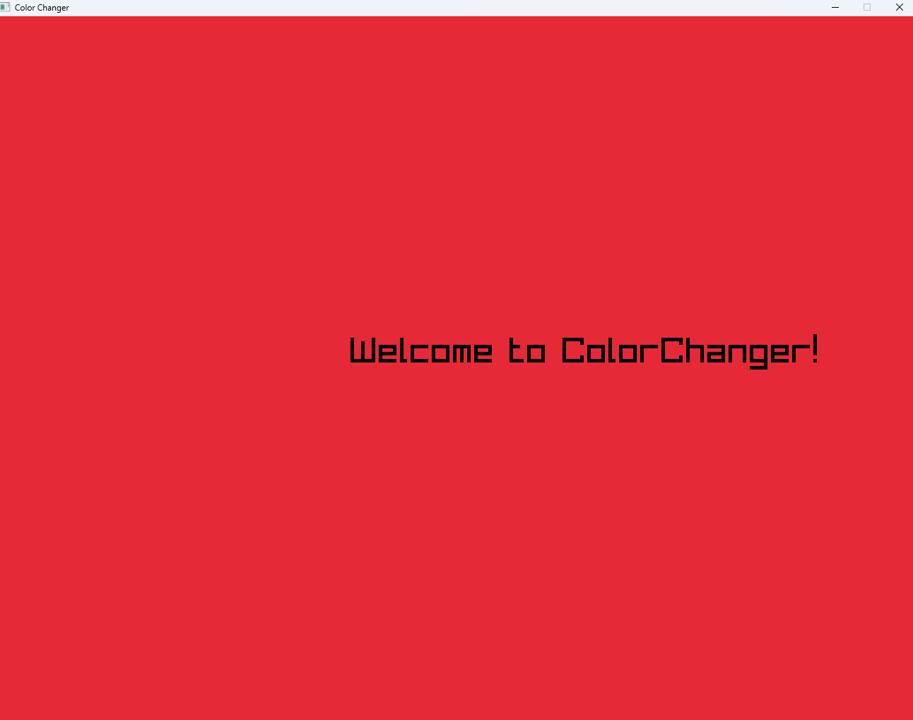

Welcome to Color Changer
_________________________________________
Made with C++ and yaml
________________________________________
change the color on screencolor.yml
_________________________________________
the default is red
if you click the exe you will see this

_______________________________________
[Click This Link to install ColorChanger](https://github.com/wolfdark1982-lgtm/Color-Changer/releases/tag/CC1.0)
________________________________________
